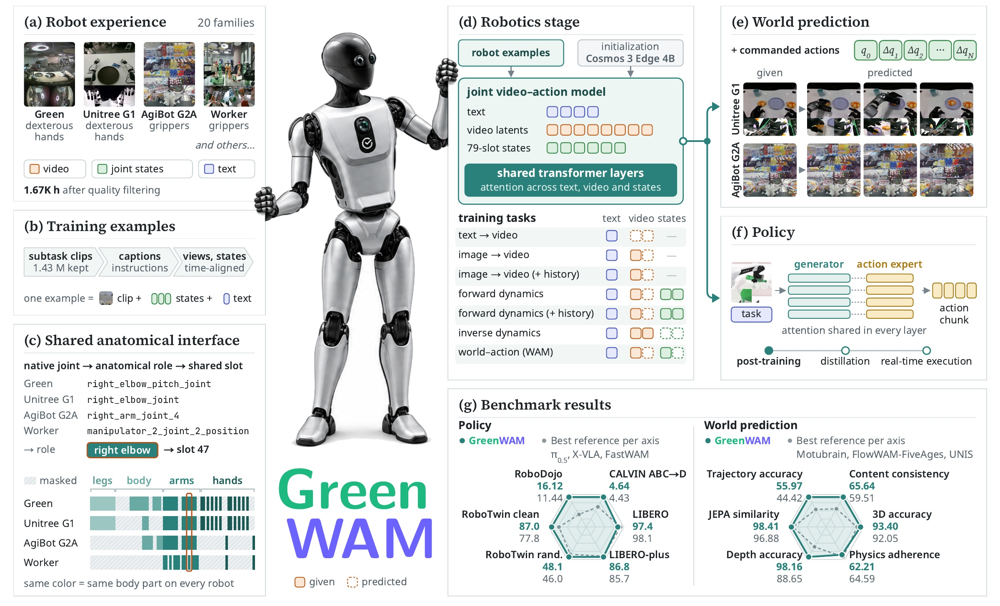

<p align="center">

</p>

<p align="center"><strong>A World Foundation Model for Robotics</strong></p>

<p align="center">
Gennady Sidorov, Valerii Kornilov, Denis Grankin, Polina Fedotova, Aleksey Postnikov<br>
<sub>Manipulation Team, Sber Robotics Center</sub>
</p>

<p align="center">
<a href="https://arxiv.org/abs/2610.18774"></a>
<a href="https://greenvla.github.io/GreenWAM/"></a>
<a href="https://huggingface.co/SberRoboticsCenter/GreenWAM"></a>
<a href="#-license"></a>
<a href="https://github.com/NVIDIA/cosmos-framework"></a>
</p>

<p align="center">

</p>

## 🧭 What is GreenWAM

A robot needs a world model that predicts how its actions change the scene and a policy that chooses those actions.
**GreenWAM** is one robot world model that serves both roles across different bodies. It is built on Cosmos 3 Edge
and trained with a three-part recipe:

- **Shared anatomical action space.** 20 robot families, from bimanual arms to dexterous humanoids, are described
  in common joint coordinates: every native joint is mapped to its anatomical role and to one of 79 shared slots.
- **Joint robotics training.** One model learns these families in visual, action-conditioned and world–action modes.
- **Action expert.** Policies split an action expert off the generator; it shares attention with it in every layer.

As a world model, GreenWAM reaches top-tier trajectory, depth and 3D accuracy on WorldArena 1.0. As a policy, it
scores among the top entries of the RoboTwin 2.0 leaderboard, reaches the highest zero-shot LIBERO-plus success
among the compared methods, and is competitive on CALVIN and LIBERO.

This repository releases the four benchmark checkpoints of the technical report together with the code that
evaluates them: policy servers, benchmark clients, the WorldArena rollout, evaluator and scoring.

## 📰 News

- **[2026-10]** 📄 [GreenWAM technical report](https://arxiv.org/abs/2610.18774). 🤗 Four benchmark checkpoints and 🧪 their evaluation code released.

## 🏆 Checkpoints and Results

| Benchmark | Role | Checkpoint | Reported result | Evaluation |
|---|---|---|---|---|
| RoboTwin 2.0 (50 tasks) | policy | [`robotwin`](https://huggingface.co/SberRoboticsCenter/GreenWAM/tree/main/robotwin) | **67.54** mean · 86.98 clean · 48.10 randomized | [guide](./benchmarks/robotwin/README.md) |
| LIBERO · LIBERO-plus | policy | [`libero`](https://huggingface.co/SberRoboticsCenter/GreenWAM/tree/main/libero) | **97.4** LIBERO · **86.8** LIBERO-plus zero-shot | [guide](./benchmarks/libero/README.md) |
| CALVIN ABC→D | policy | [`calvin`](https://huggingface.co/SberRoboticsCenter/GreenWAM/tree/main/calvin) | **4.64** average length | [guide](./benchmarks/calvin/README.md) |
| WorldArena 1.0, track 1 | world model | [`worldarena`](https://huggingface.co/SberRoboticsCenter/GreenWAM/tree/main/worldarena) | **63.31** EWMScore | [guide](./benchmarks/worldarena/README.md) |

RoboTwin 2.0 follows the leaderboard protocol (clean demonstrations for training, 100 episodes per task and
setting). Every checkpoint folder holds the EMA weights (bf16 safetensors), the `config.yaml` the evaluation reads,
the action statistics of its benchmark and a `SHA256SUMS` file.

## 🛠️ Installation

GreenWAM installs like Cosmos-Framework ([Setup](./docs/setup.md) lists the CUDA variants and system requirements):

```bash
sudo apt-get install -y --no-install-recommends curl ffmpeg git-lfs libx11-dev tree wget
# the locked environment of uv.lock; for CUDA 12.8 drivers use --group=cu128-train
uv sync --frozen --all-extras --group=cu130-train
source .venv/bin/activate && export LD_LIBRARY_PATH=
uv pip install pyzmq   # RoboTwin and CALVIN servers, if not already present
```

Each benchmark simulator or evaluator runs in its own environment; its guide gives the versions.

## 📦 Assets Preparation

**1. GreenWAM checkpoint** (one folder per benchmark):

```bash
hf download SberRoboticsCenter/GreenWAM --include "robotwin/*" --local-dir checkpoints/GreenWAM
```

**2. Wan2.2 VAE:**

```bash
hf download Wan-AI/Wan2.2-TI2V-5B Wan2.2_VAE.pth --local-dir checkpoints/Wan2.2-TI2V-5B
export WAN_VAE_PATH=$PWD/checkpoints/Wan2.2-TI2V-5B/Wan2.2_VAE.pth
```

**3. Cosmos 3 Edge text tokenizer**, at the revision the checkpoints were evaluated with:

```bash
hf download nvidia/Cosmos3-Edge --revision a9d944e2c6a1bf9f48b92ad16348e70c5f1836ba --local-dir checkpoints/Cosmos3-Edge
export COSMOS3_EDGE_DIR=$PWD/checkpoints/Cosmos3-Edge
```

The released `config.yaml` files read both paths from `WAN_VAE_PATH` and `COSMOS3_EDGE_DIR`.

## 🚀 Quick Start

Serve the RoboTwin 2.0 policy:

```bash
CKPT=checkpoints/GreenWAM/robotwin
export GREENWAM_LAYOUT_EXTENSIONS=benchmarks/robotwin/layout_extensions.json
PYTHONPATH=. python -m greenwam.infer.robotwin_policy_server --checkpoint-path $CKPT \
    --config-file $CKPT/config.yaml --stats $CKPT/stats/delta_from_q0/statistics.json --port 8101 --seed 0
```

then run the benchmark client against it from the RoboTwin environment ([guide](./benchmarks/robotwin/README.md)).
The other servers follow the same pattern:

| Benchmark | Entry point | Statistics |
|---|---|---|
| RoboTwin 2.0 | `greenwam.infer.robotwin_policy_server` | `stats/delta_from_q0/statistics.json` |
| CALVIN | `greenwam.infer.calvin_policy_server` | `calvin_stats.json` |
| LIBERO | `greenwam.infer.libero_policy_server` | `libero_stats.json` |
| WorldArena | `benchmarks/worldarena/rollout.sh` | `stats/` via `GREENWAM_STATS` |

The CALVIN and LIBERO servers also need
`GREENWAM_SEMANTIC_EXTENSIONS=benchmarks/semantic_extensions/franka_eef_v1.json`; the WorldArena rollout needs
`WORLDARENA_TEST_ROOT`.

## 🧪 Benchmark Evaluation

| Guide | What it covers |
|---|---|
| [RoboTwin 2.0](./benchmarks/robotwin/README.md) | leaderboard protocol, client on the official evaluation path, tally, paired comparison |
| [LIBERO and LIBERO-plus](./benchmarks/libero/README.md) | reference protocol, upstream client flags, per-suite and per-perturbation tally |
| [CALVIN](./benchmarks/calvin/README.md) | 1000 canonical sequences in sharded runs, aggregation |
| [WorldArena](./benchmarks/worldarena/README.md) | rollout of the test set, patched WorldArena evaluator, EWMScore and board placement |

> 💡 **Reproducibility.** On H100 GPUs, the entry points of this repository with the released weights reproduce the
> reported evaluations at the level of individual requests: 200 recorded requests per policy benchmark return
> bit-identical actions, and the WorldArena rollout reproduces 20 reported test videos byte for byte. Full runs
> keep each benchmark's own randomness; RoboTwin 2.0, for one, draws episode instructions from an unseeded
> generator (see its guide).

## 🗂️ Repository Structure

<details>
<summary>Layout</summary>

| Path | Content |
|---|---|
| `greenwam/registry/`, `greenwam/specs/` | the shared anatomical action space: slots, per-family projectors, robot specs |
| `greenwam/infer/` | evaluation entry points: three policy servers and the WorldArena world model |
| `greenwam/serving/`, `greenwam/data/` | request handling, action codecs and normalization used by the entry points |
| `benchmarks/` | benchmark clients, WorldArena evaluator patches, tallies and scoring |
| `cosmos_framework/` | NVIDIA Cosmos-Framework (release 2026-07-20) with the GreenWAM changes to the model and inference code; its README is [README_cosmos_framework.md](./README_cosmos_framework.md) |

</details>

The GreenWAM training recipes and data pipelines, the base checkpoint of the robotics stage and the training data
are not part of this release.

## 📜 License

The code and the released weights are under the [OpenMDW License 1.1](./LICENSE), the license of Cosmos-Framework
and Cosmos 3 Edge. Third-party source is listed in [NOTICE](./NOTICE), dependency notices in
[ATTRIBUTIONS.md](./ATTRIBUTIONS.md). Benchmarks, simulators, datasets and judge models are downloaded from their
sources under their own terms; some restrict use: the SAM 3 weights are gated under the SAM license, the V-JEPA
judge weights are CC BY-NC 4.0, and LIBERO-plus ships no license file at the referenced commit.

## 🙏 Acknowledgements

GreenWAM builds on [Cosmos 3](https://research.nvidia.com/labs/cosmos-lab/cosmos3/) and
[Cosmos-Framework](https://github.com/NVIDIA/cosmos-framework) by NVIDIA and on the Wan2.2 VAE. We thank the
authors of [RoboTwin 2.0](https://github.com/RoboTwin-Platform/RoboTwin), [CALVIN](https://github.com/mees/calvin),
[LIBERO](https://github.com/Lifelong-Robot-Learning/LIBERO), [LIBERO-plus](https://github.com/sylvestf/LIBERO-plus)
and [WorldArena](https://github.com/WorldArena2/WorldArena-2.0) for their benchmarks and evaluation code.

## 📝 Citation

```bibtex
@misc{sidorov2026greenwamworldfoundationmodel,
  title         = {GreenWAM: A World Foundation Model for Robotics},
  author        = {Gennady Sidorov and Valerii Kornilov and Denis Grankin and Polina Fedotova and Aleksey Postnikov},
  year          = {2026},
  eprint        = {2610.18774},
  archivePrefix = {arXiv},
  primaryClass  = {cs.RO},
  url           = {https://arxiv.org/abs/2610.18774}
}
```
